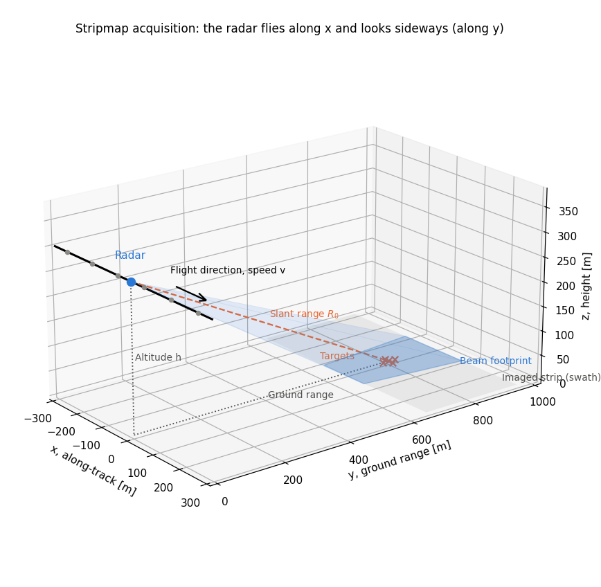
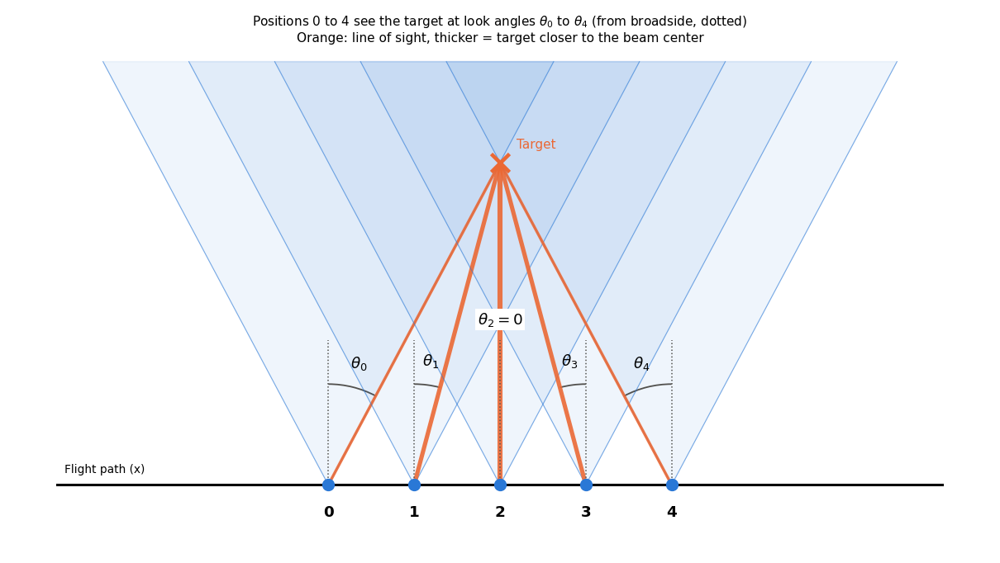
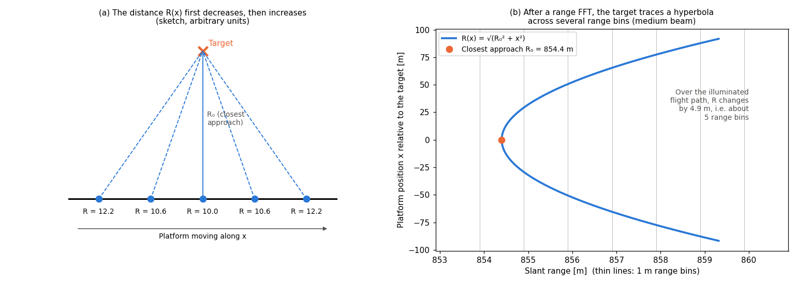
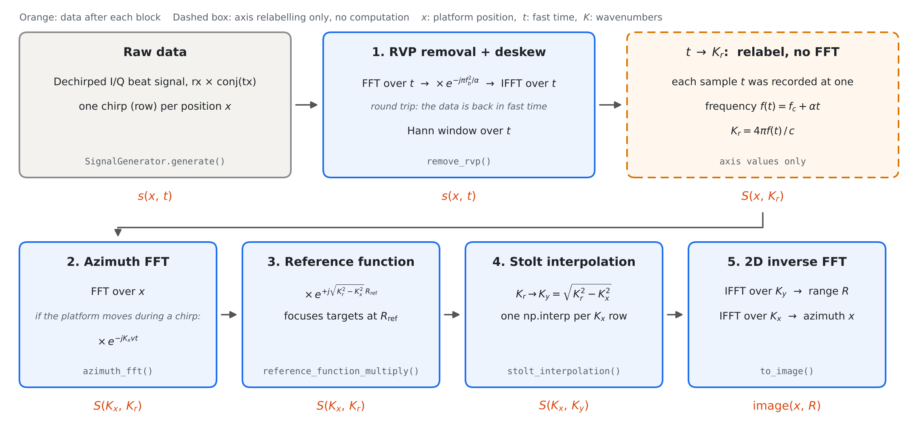
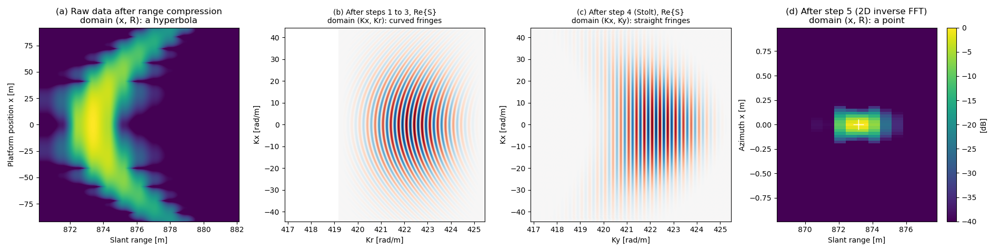
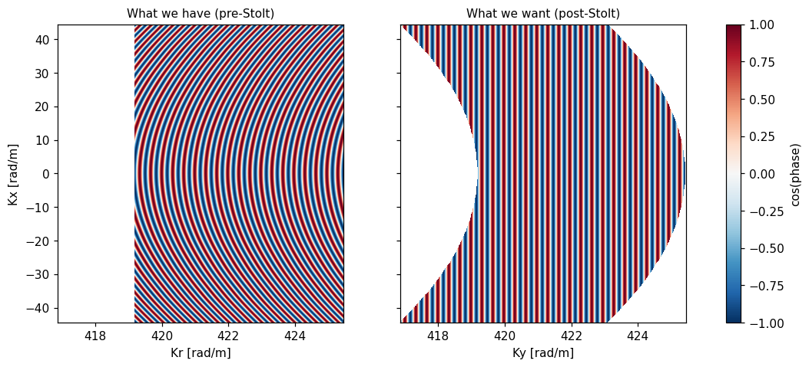
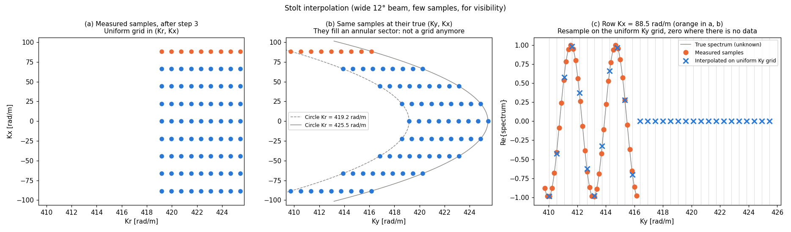
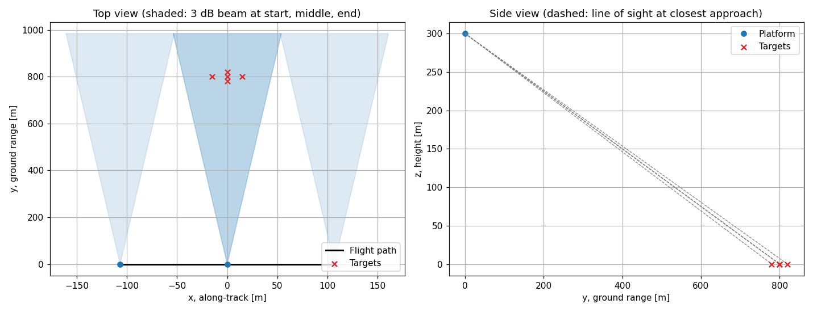
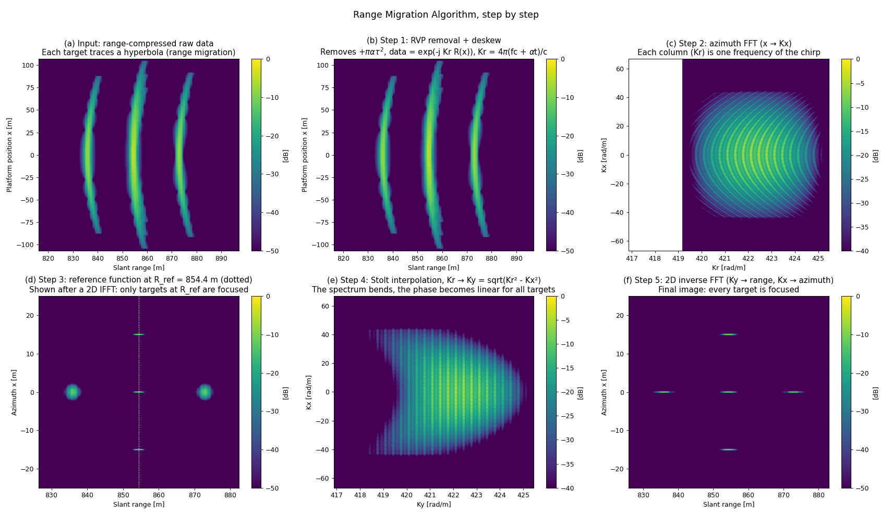

# FMCW Synthetic Aperture Radar (SAR): Stripmap mode

## Introduction
I created this tutorial as an educational resource for anyone interested in understanding the basics of how a stripmap Synthetic Aperture Radar (SAR) works. 

When I was a student, I wished I had access to tutorials like this, connecting the mathematical foundations with practical simulations. Therefore, I sincerely hope that this repo can help others bridging the gap that I had.

Please note that the concepts described below can be found in any SAR-related references. For example: 

- A. Moreira, et al. "A tutorial on synthetic aperture radar," *in IEEE Geoscience and Remote Sensing Magazine*, vol. 1, no. 1, pp. 6-43, March 2013
- M. Soumekh, *Synthetic Aperture Radar Signal Processing with MATLAB Algorithms*. New York, NY, USA: Wiley, 1999.

Finally, for transparency, I want to make it clear that AI tools were used as coding assistants to refine the implementation, improve readability, and make the code easier to follow.

## 1. What you will learn

- The FMCW signal model used in this simulation
- The stripmap SAR geometry and how the data is acquired
- Why a point target returns a hyperbola and how the range migration algorithm works

## 2. Theory and assumptions
This section took definitely longer than expected to write. Let me know if you find any mistakes. I did my best to provide all the necessary math concepts to understand how a stripmap SAR works. Basic signal and system + signal processing knowledge is required to understand what follows. 

### 2.1 FMCW radar and the IF signal

An FMCW radar transmits a linear chirp, $s_{RF}(t)$. The chirp duration is $T_c$ and has a given bandwidth $B$. The initial and final frequency are $f_c$ and $f_c + B$. Defining $\alpha = B/T_c$, $f(t) = f_c + \alpha \thinspace  t$ in $t \in [0, T_c]$.

Assuming that a target is at a given range $R$, the radar will receive an echo from the target, $s_{RF}(t-\tau)$, where $\tau = 2R/c$ ($c$ is the speed of light).

Mixing the echo with the transmitted chirp, i.e. multiplying the received signal by the complex conjugate of the transmitted one, gives the IF signal used for processing:

$$
s(t) = \exp\Big(-j 2\pi \big(\underbrace{\alpha\tau\thinspace  t}_{\text{beat frequency}} + \underbrace{f_c \tau}_{\text{carrier phase}} - \underbrace{\tfrac{\alpha}{2}\tau^2}_{\text{RVP}}\big)\Big).
$$

As a reminder, $t$ is typically called "fast time", because it is the time inside a chirp, which runs much faster than, for example, the time it takes to acquire the entire dataset.

### 2.2 Stripmap geometry

> [!NOTE]
In the following, I will be using radar and platform interchangeably. When thinking about SAR, a "platform" may refer to an aircraft or a satellite carrying the radar. 



Refer to the figure above for the geometry of the stripmap SAR. The radar flies along $x$ with a known velocity $v$ at altitude $h$ and illuminates a footprint on the ground to its side. As it moves, the footprint slides along $x$ and sweeps out the imaged strip (the swath). The distance between the radar and a target is the **slant range**; its projection on the ground is the **ground range**. The figures in the rest of this section are a top view of the same scene, looking down on the $x$ (along track) -$y$ (range) plane.

In a stripmap SAR, it can be shown that the azimuth resolution is

$$
\delta_x \approx \frac{\lambda_c}{4 \sin(\theta_a/2)},
$$

where $\lambda_c$ is the operating wavelength, $\theta_a$ is the 3 dB beamwidth of the antenna.

To get a better understanding of how the data is acquired, refer to the figure below.

The image shows the same thing as in the 3D scenario, but in 2D. A target is in a point $(x_t, R)$ (cf. the orange X), while the numbers on the flight path indicate when the radar acquires the data. The radar starts receiving echoes from the target when the target enters the radar beam (cf. position 0 in the figure above). Once the beam no longer illuminates the target, the radar receives no more returns from it (cf. position 4 in the figure above). The distance flown from position 0 to position 4 is the **synthetic aperture**: the radar effectively acts like an antenna that long. A wider beam keeps the target in view over a longer stretch and a wider range of angles, which is why it gives a finer azimuth resolution.

### 2.3 How the data is stored

For simplicity, we assume that the radar sends a **single chirp per position**. In other words, the radar sends one chirp, then moves by $\Delta x = v T_c$, transmits the next one, and so on. Chirp index and platform position are therefore the same axis.

The simulated radar has a single antenna and a single receive channel, and sends a single chirp per position, so the data is a **2D matrix**, say $S(x,t)$. 

### 2.4 Range migration

As the platform flies by, the distance to a target first decreases, then increases again. A picture is worth a thousand words, so let's take a look at the one below.



In (a), the black line represents the platform moving along the x-dimension, while the red "X" represents the target. The platform-to-target distance is shortest when the platform is right abeam of the target (third dashed line), and longest at the edges (first and last dashed lines).

In (b), we plot the radar-to-target distance. It can be shown that the curve is a hyperbola, and the distance is

$$
R(x) = \sqrt{R_0^2 + (x - x_t)^2}, \quad (\dagger)
$$

where $R_0$ is the closest-approach range (i.e. when the radar is abeam of the target), $x$ is the flight path and $x_t$ is the target's position along the flight path.

If we knew that the scene contained a single target, we might not have to worry about this. However, when multiple targets are in the scene, we need a way to "collapse" each hyperbola into a point, to be able to tell that there are indeed multiple targets. The following sections describe an algorithm that does this.

### 2.5 The range migration algorithm (RMA)

The RMA, i.e. the focusing algorithm we will use, does its work in the **2D wavenumber domain**. Let's first understand what the wavenumber domain is and how to transform the data, and then explain why we need it.

#### 2.5.1 What is a wavenumber?

A frequency counts how fast a signal oscillates in *time* (rad/s). A wavenumber is the same idea in *space*: how fast the phase changes per meter traveled (rad/m). The data, $S(x,t)$, has two axes, so it has two wavenumbers:

- $K_x$ **(azimuth wavenumber)**: describes how fast the phase of the data changes as the platform moves along $x$. It is obtained by performing a Fourier transform along $x$.
- $K_r$ **(range wavenumber)**: describes how fast the phase of an echo changes with the target's range. At a transmitted frequency $f$ it equals $K_r = 4\pi f/c$.

#### 2.5.2 How do we get the data into the wavenumber domain?

Starting from the raw matrix $S(x, t)$, each axis is converted separately:

**1. Fast time $t$ → $K_r$.** Since we have an FMCW radar, this step is a simple change of variable. Why? Consider the IF signal (cf. Section 2.1), for a target at range $R$ with delay $\tau$. Rearranging its phase gives

$$
\Delta\varphi(t) = -2\pi\thinspace (f_c + \alpha t)\thinspace \tau \thickspace +\thickspace  \pi\alpha\tau^2 .
$$

Let's ignore the second term, the RVP (it is removed in practice, cf. Section 2.5.4). Remembering that $\tau = 2R/c$, and defining $f(t) = f_c + \alpha t$, the first term becomes

$$
-2\pi f(t)\thinspace \tau \thickspace =\thickspace  -2\pi f(t)\thinspace \frac{2R}{c} \thickspace =\thickspace  -\frac{4\pi f(t)}{c}\thinspace R .
$$

Defining

$$
K_r(t) = \frac{4\pi\thinspace f(t)}{c},
$$

the IF signal can be rewritten as

$$
s(t) = e^{-jK_r(t)\thinspace R} .
$$

Each fast-time sample was recorded while the radar was transmitting one particular frequency $f(t)$, so it already *is* one $K_r$ sample: no Fourier transform is needed, only a relabeling of the axis. Since $t$ is uniformly sampled, so is $K_r$, which spans

$$
K_r \in \left[\frac{4\pi f_c}{c},\thickspace  \frac{4\pi (f_c + B)}{c}\right].
$$

Consider now a target at $(x_t, R_0)$. Its distance from the platform at position $x$ was defined in $(\dagger)$ (cf. Section 2.4). Inserting it into the IF signal gives

$$
S(x, K_r) = \exp\Big(-j K_r \sqrt{R_0^2 + (x - x_t)^2}\Big).
$$

**2. Position $x$ → $K_x$.** Take a Fourier transform along the $x$ dimension.

With the two steps described above, and without getting into the math of the Fourier transform along $x$ (it involves the principle of stationary phase and a few substitutions), it can be shown that the data in the wavenumber domain for a point target acquired with a stripmap SAR at $(x_t, R_0)$ is

$$
S(K_x, K_r) = \exp\Big(-j \sqrt{K_r^2 - K_x^2}\thickspace  R_0 \thickspace -\thickspace  j K_x x_t\Big). \quad (\star)
$$

#### 2.5.3 Why use the wavenumber domain?

It can be shown that, in the wavenumber domain, an ideal point at $(x_t, R_0)$ has the following spectrum

$$
S_p(K_x, K_y) = \exp\big(-j\thinspace K_y\thinspace R_0 \thickspace -\thickspace  j\thinspace K_x\thinspace x_t\big), \quad (\spadesuit)
$$

where $K_x$ and $K_y$ are the wavenumbers along the azimuth and range axes of the image, respectively. Note that the phase is **linear** along both axes, so a 2D inverse FFT gives a sharp peak at $(x_t, R_0)$.

Now, compare the spectrum of this ideal point, $(\spadesuit)$, with what we get from our SAR, $(\star)$. In both expressions the azimuth term is linear in $K_x$. The range term, however, is linear in $K_y$ in $(\spadesuit)$, but not linear in $K_r$ in $(\star)$. Defining

$$
K_y = \sqrt{K_r^2 - K_x^2},
$$

transforms the data that we have acquired, $(\star)$, into $(\spadesuit)$, which is what we want.

Furthermore, note how $K_y$ only contains $K_r$ and $K_x$, not $R_0$ or $x_t$, so every target is distorted in exactly the same way. We have found our "one-shot algorithm", which applies one operation to the entire dataset and removes the range migration of every target. However, our samples are evenly spaced in $K_r$, not in $K_y$. Each row must be interpolated onto a uniform $K_y$ grid, which is performed by the **Stolt interpolation** (Section 2.6).

#### 2.5.4 How does the RMA work in practice?

Section 2.5.2 and Section 2.5.3 gave us the intuition behind how the algorithm works. The diagram below fully explains how the RMA works and how it is implemented in the Python class `RangeMigrationAlgorithm`.



In one sentence: step 1 performs some pre-processing, step 2 gives us the data in the wavenumber domain, step 3 focuses the center of the scene (mainly for cosmetics), step 4 focuses everything else, and step 5 turns the spectrum into an image.

**Step 1: RVP removal and deskew.** Before we can read the fast-time axis as $K_r$, the data must look exactly like $e^{-jK_r R}$. Two things get in the way:

- the RVP term $+\pi\alpha\tau^2$ of Section 2.5.2, which we have ignored so far;
- the *skew*: the echo of each target arrives $\tau$ seconds late, so each target's beat tone starts at a different instant.

Both are easy to fix in the frequency/range domain (FFT over $t$, the fast-time). There, each target sits at its own frequency $f_b = -\alpha\tau$, so its RVP is a known function of frequency, $+\pi f_b^2/\alpha$, and multiplying by $e^{-j\pi f_b^2/\alpha}$ cancels it. The same multiplication also shifts each echo in time by its own $\tau$ (a phase that is quadratic in frequency is a delay that grows with frequency), which lines all the echoes up. An inverse FFT then brings the data back to fast time, and a Hann window over $t$ lowers the range sidelobes.
Performing the change in variables described above gives us

$$
S(x, K_r) = \exp\big(-j K_r R(x)\big), \qquad K_r = \frac{4\pi (f_c + \alpha t)}{c},
$$

**Step 2: azimuth FFT.** An FFT along the chirps takes $x$ to $K_x$, and the data is now in the formula described in $(\star)$.

**Step 2b (only if the platform moves during a chirp).** So far we assumed that each chirp is taken at a single position. If the platform keeps moving, the sample at fast time $t$ was really taken at $x + v t$. A shift along $x$ is a linear phase along $K_x$, so a single multiplication by $e^{-jK_x v t}$ undoes it.

**Step 3: reference function multiply.** We multiply the whole spectrum by $e^{+j\sqrt{K_r^2 - K_x^2}\thinspace R_\text{ref}}$, where $R_\text{ref}$ is the range of the scene center. A target at $(x_t, R_0)$ becomes

$$
\exp\Big(-j \sqrt{K_r^2 - K_x^2}\thickspace (R_0 - R_\text{ref}) \thickspace -\thickspace  j K_x x_t\Big).
$$

Why do this? The reference function is the (conjugated) spectrum of a point target placed at range $R_\text{ref}$. Typically, we know at what range we want to image, and $R_{ref}$ is usually the "center of the scene" *(I am sweeping under the rug a few other things, but I am trying to keep this section short)*.

**Step 4: Stolt interpolation.** Each $K_x$ row is resampled from $K_r$ onto a uniform grid of $K_y = \sqrt{K_r^2 - K_x^2}$ (see Section 2.6). The phase becomes

$$
\exp\big(-j K_y (R_0 - R_\text{ref}) - j K_x x_t\big),
$$

which is linear in $K_y$ and $K_x$ for **every** target. Step 3 handled the targets at $R_\text{ref}$; step 4 handles everyone else, by correcting only the *difference* between each target and the scene center.

**Step 5: 2D inverse FFT.** $K_y \rightarrow$ range, $K_x \rightarrow$ azimuth. A phase that is linear in both axes is a single 2D tone, and its inverse transform is a single peak at $(x_t,\thinspace  R_0 - R_\text{ref})$. Because step 3 moved the range origin, the range axis of the image is relative to the scene center: adding $R_\text{ref}$ back places the target at its true range $R_0$.

**Example** The figure below follows a single target through the domains of Section 2.5. It sits 19 m beyond $R_\text{ref}$, so that every step has something to do:



- **(a)** Domain $(x, R)$, after range compression (inverse FFT over $t$, since the beat frequency is negative), showing the hyperbola described in Section 2.4.
- **(b)** Domain $(K_x, K_r)$, after steps 1 to 3 (real part). The fringes are curved, because the phase $-\sqrt{K_r^2 - K_x^2}\thinspace (R_0 - R_\text{ref})$ is not linear in $K_r$ and $K_x$.
- **(c)** Domain $(K_x, K_y)$, after the Stolt interpolation. The phase is now $-K_y (R_0 - R_\text{ref})$: straight, evenly spaced fringes, i.e. a single 2D frequency.
- **(d)** Domain $(x, R)$, after the 2D inverse FFT: that single frequency becomes a single point, at the true target position (white cross).

### 2.6 The Stolt interpolation

For the purposes of this discussion, let's leave aside the $K_x$ term, which is already linear.

Recall that, after step 3, a target at $R_0 = R_\text{ref} + \Delta R$ has the phase $-\sqrt{K_r^2 - K_x^2}\thinspace \Delta R$ at every point $(K_r, K_x)$ of the spectrum, while an ideal point has the phase $-K_y\thinspace \Delta R$. The figure below shows the difference.



The left panel shows our data, plotted over $(K_r, K_x)$, in which the fringes are **curved**. The right panel shows the same data after the Stolt interpolation, plotted over $(K_y, K_x)$: the fringes are **straight**, and a 2D inverse FFT will turn them into a sharp point.

The key idea is that the values are right, but they sit at the wrong place. Specifically, compare the two phases:

- what we have, at $(K_r, K_x)$: $\thickspace -\sqrt{K_r^2 - K_x^2}\thickspace \Delta R$
- what we want, at $(K_y, K_x)$: $\thickspace -K_y\thinspace \Delta R$

They are the same expression once we write $K_y = \sqrt{K_r^2 - K_x^2}$. In other words, each measured sample already has the value of an ideal sample; it is just drawn at the wrong position on the horizontal axis. The Stolt interpolation therefore has two jobs, illustrated in the figure below.

**1. Move each sample to its correct position.** For every sample, compute $K_y = \sqrt{K_r^2 - K_x^2}$ and place the sample there. This changes no value. Going from (a) to (b): the row $K_x = 0$ does not move, since there $K_y = K_r$, while every other row slides to smaller $K_y$, more so the larger $|K_x|$. The rows no longer form a rectangle but an arc.

**2. Resample on an evenly spaced grid.** The FFT needs samples that are evenly spaced, and on the same grid for every row. After the move, they are neither. So, row by row, we join the moved samples and read off their values at evenly spaced $K_y$ positions, as shown in (c): orange dots in, blue crosses out. Where a row has no measurement, the value is set to zero. This is the only part that is an approximation, and it takes one `np.interp` per row. For the purposes of this simulation, linear interpolation is accurate enough. For larger scenes, oversampling is required.

## 3. How to run the code

Requirements: Python 3 with `numpy`, `scipy`, `matplotlib`, `tabulate` and `tqdm`.

```bash
python main.py
```

The script prints three tables (radar parameters, geometry, and focused target positions) and opens two figures: the geometry, and the RMA step by step. Generating the data takes about 10 to 20 seconds, depending on the beam.

The inputs worth changing are all in [main.py](main.py):

| Input | Where | Effect |
|---|---|---|
| `beamwidth` | `Geometry(...)` | `'wide'` (12°), `'medium'` (6°), `'narrow'` (3°) or any angle in degrees. Changes the azimuth resolution and the number of chirps |
| `targets` | list of dicts | Position (`x`, `y`, `z`) and `amplitude` of each point target |
| `platform_speed`, `altitude` | `Geometry(...)` | Distance flown between chirps, Doppler bandwidth, look angle |
| `stop_and_go` | variable | `True`: platform frozen during each chirp. `False`: platform moving, compensated by step 2b |
| `snr_db` | `SignalGenerator(...)` | `None` for no noise, or a signal-to-noise ratio per sample in dB |
| `range_window` | `RangeMigrationAlgorithm(...)` | Hann window over fast time (default `True`), lowers the range sidelobes |

To regenerate the figures of this README:

```bash
python docs/make_figures.py
```

## 4. Code walkthrough

| File | Class | Role |
|---|---|---|
| [params.py](params.py) | `Params` | Radar parameters |
| [geometry.py](geometry.py) | `Geometry` | Platform, antenna, targets |
| [signal_generator.py](signal_generator.py) | `SignalGenerator` | Raw data |
| [rma.py](rma.py) | `RangeMigrationAlgorithm` | Image formation |
| [main.py](main.py) | | Ties everything together |

**`Params`** takes $f_c$, $f_s$, $R_\text{max}$ and the bandwidth, and derives everything else: the chirp rate $\alpha$ so that $R_\text{max}$ maps to $f_s$, the chirp length $T_c$, the number of samples per chirp $N_{adc}$, and the fast-time axis `t_full`.

**`Geometry`** holds what does not depend on the radar waveform:
- the antenna beamwidth (preset or custom) and its Gaussian two-way gain, `antenna_gain(angle)`;
- the flight path, long enough for every target to enter and leave the beam, and from it the number of chirps `Nc` and the platform position at each chirp, `x_platform`;
- the sampling checks (Doppler bandwidth vs chirp rate, scene vs $R_\text{max}$), a summary table, and the geometry plot.

**`SignalGenerator.generate()`** builds the raw data matrix of shape $(N_c, N_{adc})$ with two plain loops. For every chirp it computes the platform position (one per chirp, or one per sample if the platform moves). For every target it computes the range $R$, the angle off boresight, and the antenna gain, then adds the beat signal of Section 2.1 (rx × conj(tx), i.e. with the minus sign). Noise is added at the end if `snr_db` is set.

**`RangeMigrationAlgorithm`** precomputes the three wavenumber axes in its constructor: `Kr` (one value per fast-time sample), `Kx` (one per chirp, in FFT order), and the uniform `Ky` grid for the Stolt step. `focus()` then runs one method per step of the diagram above:

| Step | Method | In one line |
|---|---|---|
| 1 | `remove_rvp()` | Zero-padded FFT over fast time, multiply by $e^{-j\pi f^2/\alpha}$, inverse FFT, Hann window over fast time |
| 2 | `azimuth_fft()` | FFT over chirps |
| 2b | `compensate_motion_during_chirp()` | Multiply by $e^{-jK_x v t}$, only if `stop_and_go=False` |
| 3 | `reference_function_multiply()` | Multiply by $e^{+j\sqrt{K_r^2 - K_x^2}\thinspace R_\text{ref}}$ |
| 4 | `stolt_interpolation()` | Loop over $K_x$ rows, `np.interp` from $\sqrt{K_r^2 - K_x^2}$ onto the $K_y$ grid |
| 5 | `to_image()` | Inverse FFT over $K_y$ (range) and over $K_x$ (azimuth), then add $R_\text{ref}$ to the range axis |

`plot_steps()` draws the step-by-step figure, and `print_target_table()` compares each target's true position with the brightest pixel near it.

## 5. Results and interpretation

All results below use the default setup: medium beam (6°), 100 m/s, 300 m altitude, five targets around 850 m slant range.

### 5.1 Geometry



Three targets share the same range and are 15 m apart along the flight path; the other two are 20 m nearer and farther in ground range (about 19 m in slant range). The flight path is about 214 m long, so each target can fully enter and leave the beam: 7113 chirps in total.

### 5.2 The RMA step by step



- **(a) Input:** after range compression, each target is a hyperbola several meters deep: the range migration. The three targets at the same range overlap in a single trace.
- **(b) Step 1:** almost identical to the input. The RVP is small, and the deskew shifts each echo by only a few microseconds out of a 300 µs chirp. The step matters for the phase, not for what you can see.
- **(c) Step 2:** the 2D spectrum. Its extent in $K_x$ (about ±44 rad/m) is set by the beam; its extent in $K_r$ by the chirp bandwidth. The fringes are the interference between the five targets.
- **(d) Step 3:** the image you would get without the Stolt step. The three targets at $R_\text{ref}$ (dotted line) are sharp; the two targets 19 m away are blurred blobs. A single reference function cannot focus every range.
- **(e) Step 4:** the spectrum after Stolt bends into an arc. Each row has slid to smaller $K_y$, and more so as $|K_x|$ grows: this is the annular sector of Section 2.6.
- **(f) Step 5:** the final image, where all five targets are focused.

### 5.3 Changing the beam

| `beamwidth` | Chirps | Theoretical azimuth resolution |
|---|---|---|
| `'wide'` (12°) | 13 361 | 7.2 cm |
| `'medium'` (6°) | 7 113 | 14.3 cm |
| `'narrow'` (3°) | 4 048 | 28.6 cm |

All three focus correctly, with and without stop-and-go. A wider beam improves the azimuth resolution but needs more chirps (roughly growing with the beamwidth squared) and a larger Doppler bandwidth, which must stay below the chirp rate $1/T_c \approx 3.33$ kHz. That is why "wide" is only 12° here.

With these parameters, switching off stop-and-go changes almost nothing: the platform moves only 3 cm (about one azimuth pixel) during a chirp. Step 2b becomes important with faster platforms or longer chirps.

## 6. Disclaimer

This project is for **educational purposes only**. It is a simplified simulation meant to explain how a stripmap FMCW SAR and the Range Migration Algorithm work. It is not a validated SAR processor, and its results should not be used for operational, scientific or engineering decisions. The code and results are provided as-is, without guarantees of accuracy or suitability for a particular application.